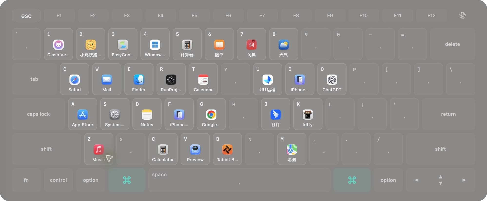
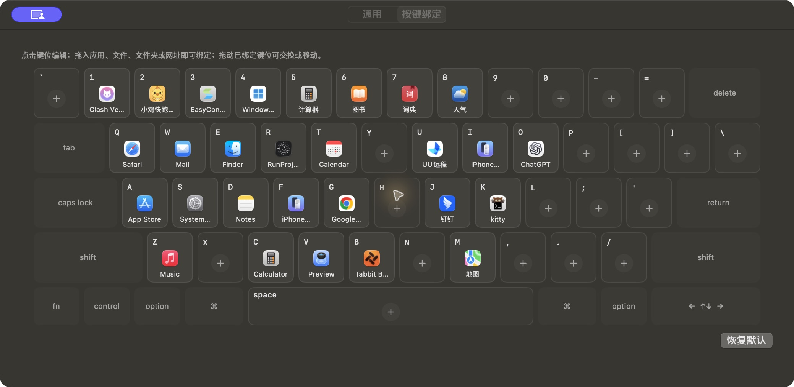

# CommandDock

[简体中文](README.md) | **English**

CommandDock is a native macOS keyboard launcher. Tap and release Command to display a MacBook keyboard in the center of the screen, then press a mapped key or click its icon to open an app, file, folder, website, or Apple Shortcut.

It is designed for Mac users who want familiar, fixed key positions for frequently used tools and destinations.

## Screenshots

The launcher shows destinations at their physical key positions. Icons depend on your local bindings.

View key binding settings

## Features

- **Multiple target types:** Bind apps, files, folders, HTTP / HTTPS websites, or existing Apple Shortcuts. Websites can use a specific browser.
- **Visual configuration:** Click a key to edit it, or drag a destination onto it. Move or swap bindings by dragging between keys.
- **Custom triggers:** Use either Command key, only the left or right key, a double tap on the same side, or a custom key combination.
- **App switching and hiding:** Launch an app, bring it forward, or optionally hide it when it is already in the foreground.
- **Pause by app:** Suspend global triggering while selected apps, such as games or remote desktop clients, are in the foreground.
- **Launch before the hint appears:** Optionally delay the keyboard display and press a mapped key immediately after triggering.
- **Configuration backup:** Import or export bindings as JSON, and optionally start at login.

## Download and install

**Requires macOS 13 Ventura or later.** Universal packages support Intel and Apple Silicon without Rosetta.

1. Download a DMG or ZIP from [GitHub Releases](https://github.com/black-lattice/CommandDock/releases/latest).
2. Place `CommandDock.app` in Applications and open it.
3. Add and enable CommandDock in System Settings → Privacy & Security → Accessibility.
4. Return to the app and choose Reconnect (重新连接). Confirm that global keyboard listening is connected.

macOS may block builds without Apple notarization. After verifying the source, use Open Anyway in Privacy & Security.

## Get started

1. Open the app's settings from its `⌘` menu bar icon and select Key Bindings (按键绑定).
2. Click a number, letter, punctuation, or space key and choose a destination.
3. Close the settings window or switch to another app, then tap and release `⌘` to show the launcher.
4. Press the mapped physical key or click its icon. The destination opens and the launcher closes.
5. Press `Esc`, tap `⌘` again, or click outside to dismiss the launcher.

Combinations such as `⌘C`, `⌘V`, `⌘Tab`, and `⌘Space` keep their normal behavior. Bindings follow physical key positions and work while using a Chinese input method.

## Customize your workflow

### Drag and bind

Drag apps, files, and folders from Finder, or URLs from your browser. Drag a binding to an empty key to move it, or onto an occupied key to swap them. Right-click to edit or clear a binding.

Apple Shortcut bindings use the full name of an existing local shortcut. Execution and permissions are handled by Apple's Shortcuts app. Update the binding if the shortcut is renamed or moved to another computer.

### Triggers and pauses

In General (通用), choose the trigger, the maximum Command hold time, and the list of apps that pause global triggering. Custom key combinations must include at least one of Control, Option, or Command.

Enable the delayed keyboard hint experiment (盲操作实验：延迟显示键盘提示) to launch with a mapped key before the keyboard appears. If you wait, the keyboard becomes visible. Show Launcher (显示浮窗) in the menu bar always opens it immediately.

### Back up and move bindings

Export a JSON file in settings and import it on another computer. The file contains launch targets, selected browsers, and app hide options. General preferences, including triggers and pause lists, are configured separately on each computer. Referenced apps, files, and shortcuts must be available on the destination computer.

## Privacy and usage notes

- Built with native Swift, AppKit, and SwiftUI. Configuration stays on your computer; the app does not save typed input, read window contents, or upload data.
- The layout follows an ANSI MacBook keyboard. Extra ISO / JIS keys are not shown.
- Secure input, such as password fields, and system states such as the lock screen can suspend global triggering.
- Command triggering pauses while the settings window is receiving keyboard input. You can still show the launcher from the menu bar.
- If listening stops after an update or moving the app, check Accessibility permissions. If necessary, remove the old entry, add the copy in Applications, and restart it.

## Feedback

Report problems or suggest features through [GitHub Issues](https://github.com/black-lattice/CommandDock/issues).

[MIT License](LICENSE)
