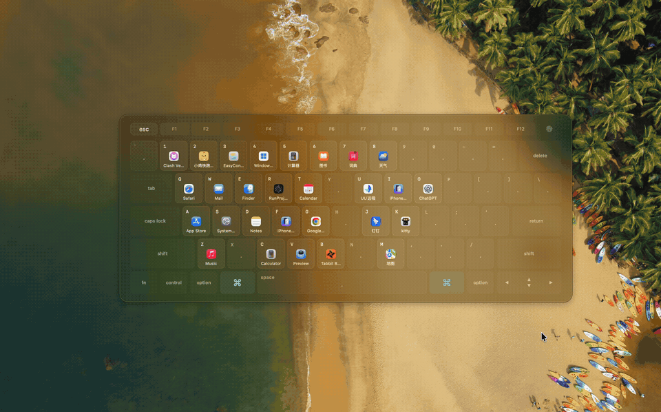
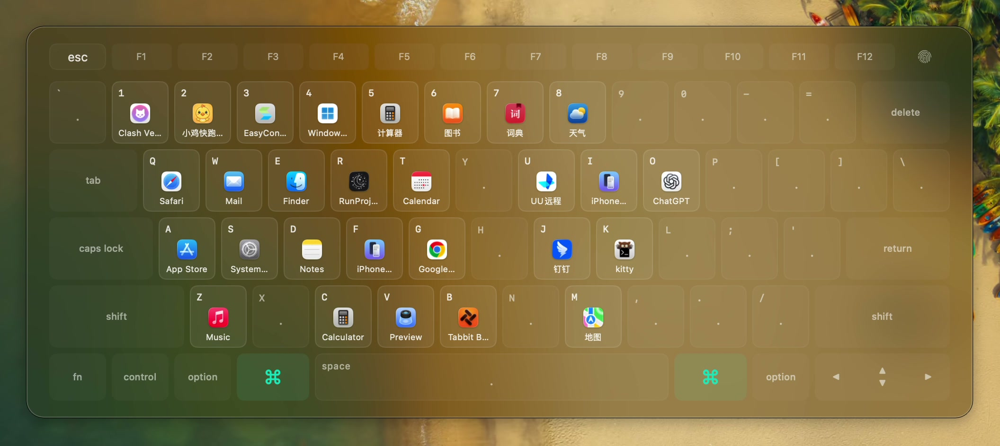
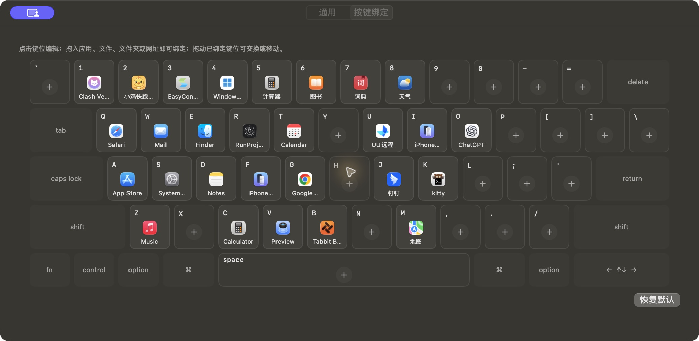

# CommandDock

**简体中文** | [English](README.en.md)

CommandDock 是原生 macOS 键盘式快捷启动器。轻按并松开 Command，就能在屏幕中央看到一张 MacBook 键盘；按对应键位或点击图标，即可打开常用应用、文件、文件夹、网址或运行快捷指令。

适合希望通过固定键位快速访问常用工具、减少反复查找和切换的 Mac 用户。

## 操作演示

呼出键盘，按已绑定的键位打开音乐应用。点击动图可查看原画质视频。

[观看原画质视频（MP4）](docs/media/commanddock-demo.mp4)

## 界面预览

快捷启动浮窗按物理键位展示绑定目标，图标随本机配置变化。

查看按键绑定设置

## 核心功能

- **多种启动目标**：绑定应用、文件、文件夹、HTTP / HTTPS 网址或本机快捷指令；网址可指定浏览器。
- **可视化键位配置**：点击键位编辑，或拖入目标；拖动已有绑定可移动或交换位置。
- **自定义呼出方式**：支持单击任意侧、仅左侧、仅右侧 Command，双击同侧 Command，以及自定义组合键。
- **应用切换与隐藏**：打开未运行的应用，切换到后台应用，也可为绑定开启前台应用隐藏功能。
- **按应用暂停**：在游戏、远程桌面等指定应用处于前台时暂停全局呼出。
- **熟练操作模式**：可延迟显示键盘提示，在浮窗出现前直接按绑定键完成启动。
- **配置备份**：导入、导出 JSON 绑定文件，支持登录时自动启动。

## 下载与安装

**系统要求：macOS 13 Ventura 或更新版本。** Universal 安装包同时支持 Intel 和 Apple Silicon，无需 Rosetta。

1. 从 [GitHub Releases](https://github.com/black-lattice/CommandDock/releases/latest) 下载 DMG 或 ZIP。
2. 将 `CommandDock.app` 放入「应用程序」并打开。
3. 在「系统设置 → 隐私与安全性 → 辅助功能」中添加并启用 CommandDock。
4. 回到设置点击「重新连接」，确认全局键盘监听已连接。

未经过 Apple 公证的安装包可能被系统拦截。确认来源后，可在「隐私与安全性」中使用「仍要打开」。

## 开始使用

1. 在菜单栏 `⌘` 图标中打开「应用绑定与设置」，进入「按键绑定」。
2. 点击一个数字、字母、标点或空格键，为它选择启动目标。
3. 关闭设置窗口或切换到其他应用，轻按并松开 `⌘` 呼出键盘。
4. 按已绑定的物理键位，或直接点击图标，启动目标并收起浮窗。
5. 按 `Esc`、再次轻按 `⌘` 或点击外部可关闭浮窗。

`⌘C`、`⌘V`、`⌘Tab`、`⌘Space` 等组合键保持原有用途。浮窗采用物理键位定位，中文输入法下也可直接使用。

## 配置常用操作

### 拖拽与绑定

从 Finder 拖入应用、文件或文件夹，也可从浏览器拖入网址。拖动一个已有绑定到空键位可移动位置，拖到已绑定键位可交换；右键可编辑或清除。

快捷指令绑定使用本机已有指令的完整名称。指令执行及授权由 Apple 快捷指令 App 处理，改名或换电脑后需同步更新绑定。

### 呼出与暂停

在「通用」中选择呼出方式、Command 最长按住时间和暂停应用列表。自定义快捷键需要包含 Control、Option、Command 中的至少一项。

开启「盲操作实验：延迟显示键盘提示」后，可在提示出现前按绑定键启动目标；等待后才显示键盘。也可从菜单栏选择「显示浮窗」立即查看。

### 备份与换机

在设置中导出 JSON，换机后导入。绑定文件包含启动目标、指定浏览器及应用隐藏选项；呼出方式、暂停列表等通用偏好需在本机单独设置。目标应用、文件及快捷指令需要在新电脑上可用。

## 隐私与使用须知

- 原生 Swift、AppKit 与 SwiftUI 应用，配置保存在本机；不保存键盘输入、不读取窗口内容、不上传数据。
- 布局基于 ANSI MacBook 键盘，ISO / JIS 键盘的额外键位未展示。
- 密码框的安全输入模式、锁屏等系统限制可能暂停全局触发。
- 设置窗口正在接收键盘输入时暂停 Command 呼出；菜单栏仍可手动显示浮窗。
- 更新或移动应用后若无法监听，请确认辅助功能授权，必要时移除旧条目，再添加「应用程序」中的应用并重启。

## 反馈

遇到问题或有功能建议，欢迎提交 [Issue](https://github.com/black-lattice/CommandDock/issues)。

[MIT License](LICENSE)
